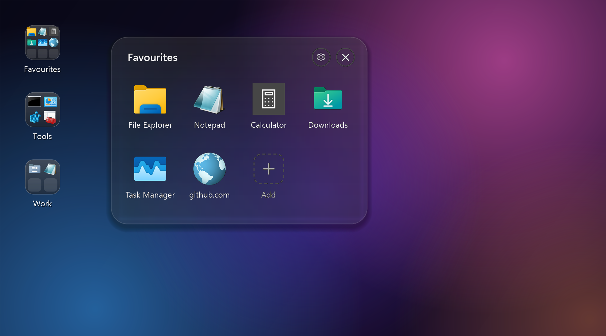
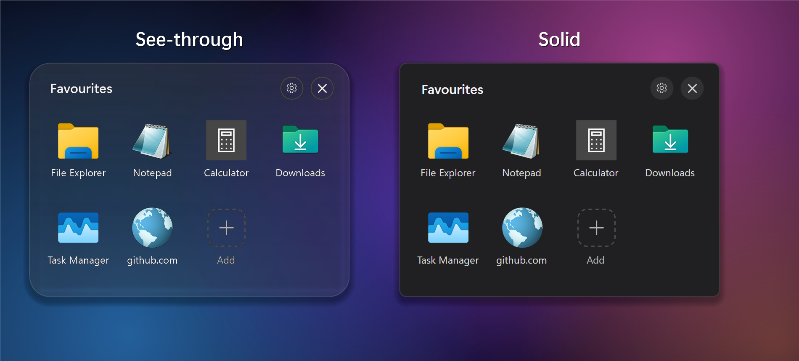
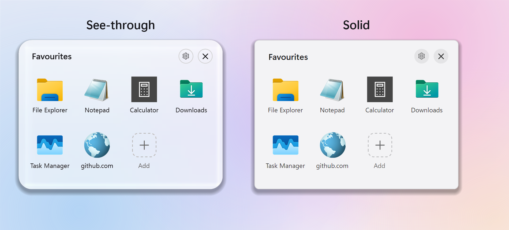
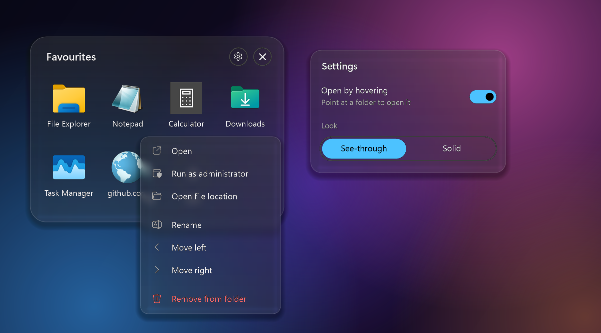
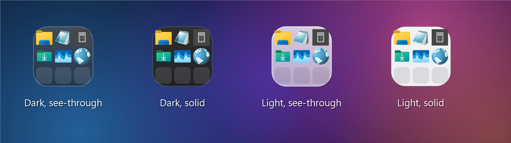

<div align="center">


# Prysm Folder

**Phone-style app folders for your Windows desktop.**
Group your apps, folders and websites into a folder that opens the moment you point at it,
in a glassy Windows 11 style.

[**⬇ Download the latest version**](../../releases/latest) &nbsp;·&nbsp; Windows 11 &nbsp;·&nbsp; Free &amp; open source (MIT)



</div>

---

## Why?

Phones solved desktop clutter years ago: put related apps in a folder, tap it, pick one.
On Windows you get either a crowded desktop or a trip through the Start menu.
**Prysm Folder** brings the phone way to the desktop: one tidy icon that shows a preview of
what's inside, opens instantly when you point at it, and gets out of the way the moment
you click something else.

## Features

- **Make a folder right on the desktop.** Right-click the desktop → **New → Prysm Folder**, type a name. Done.
- **Opens when you point at it.** No clicking needed: rest the pointer on the folder and it pops open with a
  springy animation. Move away and it closes. (Double-clicking works too, and you can turn hovering off.)
- **Put anything in it.** Apps, shortcuts, files, folders and websites. Drag them onto the folder's icon, or
  pause on the icon mid-drag and the folder **springs open** so you can drop them exactly where you want.
- **Live icon.** The desktop icon is a mini-grid of what's inside, just like on a phone.
- **Two looks, light or dark.** **See-through** blurred glass, or a **Solid** panel. Both follow Windows'
  light/dark mode, and the desktop icon matches.
- **Phone-style reordering.** Drag an app and the others slide out of the way.
- **Follows your files.** Moved or renamed a folder or file that's in a Prysm Folder? It still opens.
- **Closes the instant you click away**, with a quick fade.
- **Tiny and self-contained.** One small `.exe` (about 160 KB), no frameworks to install, nothing sent anywhere.

<div align="center">

<br><sub>See-through and Solid, in dark mode…</sub>
<br><br>

<br><sub>…and in light mode.</sub>
</div>

## Install

1. Download **`Prysm Folder.exe`** from the [latest release](../../releases/latest).
2. Double-click it and choose **Yes** to install.
3. Click **Yes** on the Windows permission prompt. (Windows 11 only lists a new file type in the
   right-click **New** menu if it's registered for the whole PC; that's the only thing it's needed for.
   If you skip it, Prysm Folder still works, but **New → Prysm Folder** is only under **Show more options**.)

> **"Windows protected your PC"?** New apps that aren't code-signed yet get this warning.
> Click **More info → Run anyway**. The full source code is right here if you'd like to check it, or
> [build it yourself](#build-it-yourself).

Prysm Folder installs just for your account, into `%LOCALAPPDATA%\Programs\Prysm Folder`.
To remove it: **Settings → Apps → Installed apps → Prysm Folder → Uninstall**. Your folders stay on the
desktop as files (they'll open again if you reinstall).

## How to use it

| | |
|---|---|
| **Make a folder** | Right-click the desktop → **New → Prysm Folder** and type a name. |
| **Open it** | Point at it (or double-click it). |
| **Add things** | Drag apps, files or folders onto its icon (or pause there to drop them inside). Or click **+** inside the folder for **Apps or files**, **A folder** or **A website**. Ctrl+V pastes copied files. |
| **Open something** | Click it. The folder closes itself. |
| **Reorder** | Drag an app to a new spot. |
| **Rename** | Click the folder's name at the top, or rename it on the desktop like any file. |
| **App options** | Right-click an app: open, run as administrator, open file location, rename, move, remove. |
| **Close** | Click anywhere else, press Esc, or click the **✕**. |
| **Settings** | The gear next to the ✕: hover-to-open on/off, and See-through or Solid. |

<div align="center">

<br><sub>Right-click menu and settings, in the same style.</sub>
</div>

### The desktop icon

Each folder's icon shows the first apps inside it, and its frame follows your look and Windows' light/dark mode:

<div align="center">

</div>

## FAQ

**Does it run in the background?**
A small helper starts with Windows so folders can open when you point at them. It uses almost no CPU
and no network. If you turn **Open by hovering** off in settings, it just sits idle.

**Where are my folders stored?**
Each Prysm Folder *is* the file on your desktop (a `.appfolder` file holding its icon and list of items),
so you can move, copy, back up or delete it like any other file. Settings live in
`HKEY_CURRENT_USER\Software\AppFolder`.

**Hovering doesn't open my folders.**
Check the gear → **Open by hovering** is on. Opening any folder by double-clicking also restarts the
hover helper if it isn't running. A log is kept at `%TEMP%\PrysmFolder.log`.

**A folder's icon on the desktop didn't update.**
Windows sometimes holds on to old icons; pressing **F5** on the desktop (or signing out and in) refreshes them.

**Does it work on Windows 10?**
Prysm Folder is made for, and tested on, Windows 11 only.

## Build it yourself

No tools needed beyond Windows itself: Prysm Folder is a single C# file compiled with the C# compiler
that ships with Windows (.NET Framework 4.8).

```bat
git clone https://github.com/Peteboii/Prysm-Folder.git
cd Prysm-Folder
build.bat
```

That produces `Prysm Folder.exe`. Run it to install, or use `"Prysm Folder.exe" --install` /
`--uninstall` (add `--quiet` to skip the dialogs).

### How it works (for the curious)

- **The folder file** is a real `.ico` image with the folder's settings appended, and the file type's icon is
  set to "the file itself", which is how each folder gets its own live mini-grid icon.
- **See-through glass** is built the same way as Windows 11's own acrylic: Windows' blurred *host backdrop*
  (via `Windows.UI.Composition`) clipped to rounded corners, with a tint, sheen and hairline rim on top.
- **Hover-to-open** reads which desktop icon is under the pointer straight from the desktop's icon list.
- **Following moved files** uses each file's NTFS file ID, which stays the same when it moves on the same drive.

## License

[MIT](LICENSE). Free to use, change and share.

Made by Dippy_drippy. Windows is a trademark of Microsoft Corporation; Prysm Folder isn't affiliated with Microsoft.
